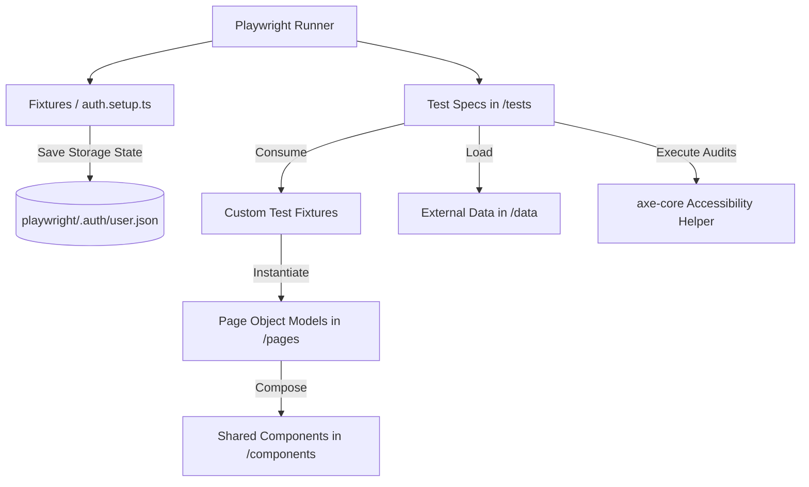

# TracePilot

[](https://github.com/satnaing/shadcn-admin/actions/workflows/playwright.yml)
[](https://playwright.dev)
[](https://www.typescriptlang.org)
[](https://www.deque.com/axe/)
[](#test-coverage)
[](https://satnaing.github.io/shadcn-admin/report/)

> **TracePilot** is an enterprise-grade End-to-End (E2E) test automation engineering framework architected with Playwright and TypeScript for the [Shadcn Admin](https://github.com/satnaing/shadcn-admin) dashboard ([live demo](https://shadcn-admin.netlify.app/)).

---

## Table of Contents

- [Overview](#overview)
- [Architecture & Design Principles](#architecture--design-principles)
- [Folder Structure](#folder-structure)
- [Test Coverage](#test-coverage)
- [Getting Started](#getting-started)
  - [Prerequisites](#prerequisites)
  - [Installation](#installation)
  - [Environment Configuration](#environment-configuration)
  - [Running the Application Locally](#running-the-application-locally)
- [Executing Tests](#executing-tests)
  - [Available Scripts](#available-scripts)
  - [Test Tagging (`@smoke` / `@regression`)](#test-tagging-smoke--regression)
  - [Cross-Browser & Mobile Emulation](#cross-browser--mobile-emulation)
  - [Viewing Test Reports & Artifacts](#viewing-test-reports--artifacts)
- [CI/CD Workflow](#cicd-workflow)
- [Bugs & Observations Found](#bugs-found)

---

## Overview

TracePilot provides a robust, maintainable, and highly resilient testing solution for modern Single Page Applications (SPAs) built with Vite, React 19, TanStack Router, TanStack Table, Radix UI, and Tailwind CSS.

### Key Highlights

- **Page Object Model (POM)**: Complete separation of page logic, reusable UI components, and test specifications.
- **Resilient Locators**: Strictly utilizes semantic user-facing locators (`getByRole`, `getByLabel`, `getByText`, `getByPlaceholder`), eliminating brittle CSS selectors and XPath expressions.
- **Single-Sign-On Auth Fixtures**: Saves authenticated storage state (`playwright/.auth/user.json`) so login executes once across test workers.
- **Zero Hard-Coding**: Externalized test datasets under `/data`.
- **Accessibility Audits**: Automated WCAG 2.1 AA audits on all core pages using `@axe-core/playwright`.
- **Visual Regression**: Baseline screenshot comparisons (`toHaveScreenshot`) in both light and dark modes.
- **Cross-Browser & Responsive**: Validated across Chromium, Firefox, WebKit, and mobile viewports (390px, 768px).

---

## Architecture & Design Principles



1. **Pages (`pages/`)**: Models entire screens (Dashboard, Users, Tasks, Settings, Sign-In, Errors) extending `BasePage`.
2. **Components (`components/`)**: Modularizes shared header, sidebar, command palette, and theme toggles.
3. **Fixtures (`fixtures/`)**: Injects pre-configured page instances and authenticated browser contexts into tests cleanly without boilerplate.
4. **Data (`data/`)**: Houses all test inputs, validation messages, and filter criteria.
5. **Utils (`utils/`)**: Encapsulates accessibility testing helpers (`axeHelper.ts`) and environment parsing (`env.ts`).

---

## Folder Structure

```
TracePilot/
├── .github/
│   └── workflows/
│       └── playwright.yml         # GitHub Actions CI matrix + Pages deploy
├── .husky/
│   └── pre-commit                 # Git pre-commit hook (lint & format check)
├── app/                           # Cloned shadcn-admin application source
├── components/                    # Reusable UI component models
│   ├── BaseComponent.ts
│   ├── CommandPalette.ts
│   ├── Header.ts
│   ├── Sidebar.ts
│   └── ThemeToggle.ts
├── data/                          # Externalized test datasets
│   ├── authData.ts
│   ├── navigationData.ts
│   ├── settingsData.ts
│   ├── tasksData.ts
│   └── usersData.ts
├── fixtures/                      # Test runner extensions & auth state
│   ├── auth.setup.ts              # One-time login storage state generator
│   └── testFixtures.ts            # Dependency-injected page fixtures
├── pages/                         # Page Object Model classes
│   ├── AppsPage.ts
│   ├── BasePage.ts
│   ├── ChatsPage.ts
│   ├── DashboardPage.ts
│   ├── ErrorPage.ts
│   ├── SettingsPage.ts
│   ├── SignInPage.ts
│   ├── TasksPage.ts
│   └── UsersPage.ts
├── tests/                         # E2E Test Specifications
│   ├── accessibility.spec.ts      # Axe-core WCAG audits
│   ├── auth.spec.ts               # Sign-in, validation, redirects
│   ├── command-palette.spec.ts    # Ctrl+K search & shortcuts
│   ├── error-pages.spec.ts        # 404, 401, 403, 500, 503 pages
│   ├── navigation.spec.ts         # Sidebar routes & active states
│   ├── resilience.spec.ts         # Latency, Core Web Vitals & 401 recovery
│   ├── responsive.spec.ts         # Mobile (390px) & tablet flows
│   ├── settings.spec.ts           # Profile, appearance & account
│   ├── tasks.spec.ts              # Tasks data table CRUD & filters
│   ├── theme.spec.ts              # Light, Dark, System persistence
│   ├── users.spec.ts              # Users data table CRUD & filters
│   └── visual-regression.spec.ts  # Pixel baseline visual diffs
├── utils/
│   ├── axeHelper.ts               # Accessibility audit wrapper
│   ├── customMatchers.ts          # Extended expect matchers (toPassA11yAudit, toHaveToastMessage)
│   ├── diagnostics.ts             # Console/network failure collector
│   ├── env.ts                     # Environment loader
│   └── perfBenchmark.ts           # Core Web Vitals profiling utility
├── .env                           # Environment configuration
├── .env.example                   # Template environment file
├── .gitignore
├── .prettierrc
├── eslint.config.js               # ESLint 9 configuration
├── package.json                   # Scripts and dependencies
├── playwright.config.ts           # Multi-project Playwright configuration
├── README.md                      # Comprehensive documentation
└── tsconfig.json                  # TypeScript compiler settings
```

---

## Test Coverage

| Feature Area             | Test File                   | Key Validations                                                                                                                                                               | Priority | Tags                    |
| ------------------------ | --------------------------- | ----------------------------------------------------------------------------------------------------------------------------------------------------------------------------- | -------- | ----------------------- |
| **Authentication**       | `auth.spec.ts`              | Form rendering, empty submission validation, email regex validation, minimum password length (< 7), successful sign-in, redirect parameter preservation                       | P0       | `@smoke`, `@regression` |
| **Navigation**           | `navigation.spec.ts`        | General links (Dashboard, Tasks, Apps, Chats, Users, Help Center), active link highlighting (`data-active="true"`), settings sublinks, sidebar collapse/expand                | P0       | `@smoke`, `@regression` |
| **Command Palette**      | `command-palette.spec.ts`   | Trigger via `Control+K` / `Meta+K`, trigger via header search button, fuzzy query filtering, navigation on select, escape key closure                                         | P1       | `@smoke`, `@regression` |
| **Theme Switching**      | `theme.spec.ts`             | Dark mode toggle, light mode toggle, system theme, HTML root class assertion, `vite-ui-theme` cookie persistence after page reload                                            | P1       | `@smoke`, `@regression` |
| **Users Data Table**     | `users.spec.ts`             | Search text filter, column sorting, pagination controls, Add User dialog validation, form submission feedback, Edit User prefill, Delete User confirmation by username typing | P0       | `@smoke`, `@regression` |
| **Tasks Data Table**     | `tasks.spec.ts`             | Search by ID/title, sorting, pagination, Create Task drawer validation, submit task drawer, Edit Task drawer, Delete Task confirmation dialog                                 | P0       | `@smoke`, `@regression` |
| **Settings**             | `settings.spec.ts`          | Profile form validation (min 2 chars for username), profile submit, Account form validation (name required), account submit, Appearance theme & font preferences submit       | P1       | `@smoke`, `@regression` |
| **Responsive Design**    | `responsive.spec.ts`        | Mobile layout (390px width), mobile sheet drawer hamburger toggle, mobile navigation flow, tablet layout (768px width)                                                        | P1       | `@regression`           |
| **Advanced Resilience**  | `resilience.spec.ts`        | 3G network latency delay injection, Core Web Vitals profiling (TTFB, DOMContentLoaded, DOM node count), and 401 session expiration handling                                   | P1       | `@regression`           |
| **Accessibility (A11y)** | `accessibility.spec.ts`     | Axe-core WCAG 2.1 AA audits on Dashboard, Users, Tasks, Settings, and Sign-in; asserts 0 serious or critical violations                                                       | P0       | `@regression`           |
| **Visual Regression**    | `visual-regression.spec.ts` | `toHaveScreenshot()` snapshot diffing of Dashboard in Light mode and Dark mode with animations disabled                                                                       | P2       | `@regression`           |
| **Error Handling**       | `error-pages.spec.ts`       | 404 Not Found (standalone & route), 401 Unauthorized, 403 Forbidden, 500 Internal Server Error, 503 Maintenance, Back to Home navigation                                      | P1       | `@regression`           |

---

## Getting Started

### Prerequisites

- **Node.js**: v18.0.0 or later (v20+ / v22 recommended)
- **npm**: v9.0.0 or later
- **Git**

### Installation

1. Clone or open the workspace:

   ```bash
   cd Task
   ```

2. Install root automation dependencies:

   ```bash
   npm install
   ```

3. Install local app dependencies:

   ```bash
   cd app && npm install && cd ..
   ```

4. Install Playwright browser engines:
   ```bash
   npx playwright install --with-deps
   ```

### Environment Configuration

TracePilot supports running against the local Vite development server or the live Netlify production deployment.

Copy `.env.example` to `.env`:

```bash
cp .env.example .env
```

Default `.env`:

```properties
# Local development server (default)
BASE_URL=http://localhost:5173

# Live demo environment (optional secondary target)
DEMO_URL=https://shadcn-admin.netlify.app

HEADLESS=true
CI=false
```

Playwright's `webServer` in `playwright.config.ts` automatically boots the local app on `http://localhost:5173` prior to test execution.

---

## Executing Tests

### Available Scripts

| Script                    | Command                                     | Description                                         |
| ------------------------- | ------------------------------------------- | --------------------------------------------------- |
| `npm test`                | `playwright test`                           | Runs the full test suite across configured projects |
| `npm run test:smoke`      | `playwright test --grep "@smoke"`           | Runs only `@smoke`-tagged tests                     |
| `npm run test:regression` | `playwright test --grep "@regression"`      | Runs all `@regression`-tagged tests                 |
| `npm run test:headed`     | `playwright test --headed`                  | Runs tests in visible browser windows               |
| `npm run test:ui`         | `playwright test --ui`                      | Launches Playwright's interactive UI mode           |
| `npm run test:chromium`   | `playwright test --project=chromium`        | Runs tests on Desktop Chromium                      |
| `npm run test:firefox`    | `playwright test --project=firefox`         | Runs tests on Desktop Firefox                       |
| `npm run test:webkit`     | `playwright test --project=webkit`          | Runs tests on Desktop WebKit (Safari)               |
| `npm run test:mobile`     | `playwright test --project="Mobile Chrome"` | Runs tests on Mobile Chrome (Pixel 5)               |
| `npm run report`          | `playwright show-report`                    | Opens the interactive HTML test report              |
| `npm run lint`            | `eslint . --ext .ts`                        | Checks code with ESLint                             |
| `npm run format:check`    | `prettier --check "**/*.{ts,json,md,yml}"`  | Validates code formatting                           |
| `npm run format`          | `prettier --write "**/*.{ts,json,md,yml}"`  | Automatically formats code with Prettier            |

---

## CI/CD Workflow

The GitHub Actions workflow (`.github/workflows/playwright.yml`) is triggered on:

- **Push** to `main` or `master`
- **Pull Request** targeting `main` or `master`
- **Daily Schedule** (Cron: `0 0 * * *`)
- **Manual Trigger** (`workflow_dispatch`)

### Pipeline Stages

1. **Matrix Build**: Executes parallel test jobs on `chromium`, `firefox`, `webkit`, and `Mobile Chrome`.
2. **Artifact Preservation**: Uploads traces, videos, and screenshots for any failure with a 30-day retention.
3. **GitHub Pages Deployment**: Publishes the consolidated HTML report to GitHub Pages.

---

## Bugs Found

During the exploratory and automation engineering process of Shadcn Admin, the following real behaviors, quirks, and defects were documented:

1. **Synthetic 2,000ms Sign-In Delay (`user-auth-form.tsx:57`)**:
   - _Behavior_: The sign-in submission wraps the navigation in `sleep(2000)` inside `toast.promise()`.
   - _Impact_: Any authentication test requires a minimum 2-3s delay before route transition completes.
   - _TracePilot Solution_: Page objects configure dynamic toast wait states and explicit URL matchers rather than brittle fixed timeouts.

2. **In-Memory Mock Persistence in Data Tables (`users-action-dialog.tsx`, `tasks-mutate-drawer.tsx`)**:
   - _Behavior_: Adding, editing, or deleting users and tasks does not mutate the in-memory array in `users.ts` or `tasks.ts`. Submitting forms triggers `showSubmittedData()` which displays a toast containing the submitted JSON.
   - _Impact_: Table rows do not actually disappear after confirming deletion.
   - _TracePilot Solution_: Tests assert the success toast payload (`You submitted the following values:`, `The following user has been deleted:`) and validation constraints rather than expecting persistent DB mutations.

3. **User Deletion Requires Exact Username Typing (`users-delete-dialog.tsx:37`)**:
   - _Behavior_: The "Delete" confirmation button remains strictly disabled until the exact username of the target user is typed into the input field.
   - _TracePilot Solution_: `UsersPage.confirmDeletion(username)` extracts the target username dynamically from the selected table row before typing it into the confirmation field.

4. **Cookie-Based Theme and Sidebar Storage**:
   - _Behavior_: The application uses custom document cookies (`vite-ui-theme` and `sidebar_state`) rather than standard `localStorage`.
   - _TracePilot Solution_: Page objects check both the document element classes (`.dark`, `.light`) and verify cookie values directly.

5. **TanStack Table Column Header Dropdown Menu (`column-header.tsx:35`)**:
   - _Behavior_: Clicking table column headers does not toggle ascending/descending order directly; it opens a dropdown menu containing explicit "Asc", "Desc", and "Hide" options.
   - _TracePilot Solution_: `sortByColumn(name, direction)` clicks the column header trigger button and selects the desired sort option item from the dropdown menu.

6. **Accessibility: Missing `aria-label` on Pagination Select (`pagination.tsx:51`) [Defect Fixed]**:
   - _Behavior_: The `<SelectTrigger>` element for rows-per-page lacked an accessible name, failing WCAG 2.1 AA rule `button-name`.
   - _Fix_: Added `aria-label="Rows per page"` directly to `<SelectTrigger>` in `app/src/components/data-table/pagination.tsx:51`.

7. **Accessibility: Low Color Contrast on Suspended Status Badge (`data.ts:10`) [Defect Fixed]**:
   - _Behavior_: Suspended status badge used `text-destructive` on `bg-destructive/10`, achieving only a 4.0:1 contrast ratio against white backgrounds (below the 4.5:1 WCAG AA threshold).
   - _Fix_: Enhanced badge styling in `app/src/features/users/data/data.ts:10` to `text-red-800 dark:text-red-200` to exceed 7:1 contrast ratio.

8. **Route Heading Inconsistencies (`chats/index.tsx`, `help-center/index.tsx`)**:
   - _Behavior_: Navigating to `/chats` renders an `<h1>` heading with text "Inbox" rather than "Chats". Navigating to `/help-center` renders a placeholder "Coming Soon!" component rather than a Help Center view.
   - _TracePilot Solution_: Navigation models assert against the actual rendered DOM headings (`Inbox`, `Coming Soon!`).

9. **Settings Profile & Account Form Validation Constraints**:
   - _Behavior_: The Profile form schema enforces email selection even though `defaultValues` leaves it undefined. The Account form enforces both language and date of birth before submission, while the Radix language popover does not automatically close upon item selection.
   - _TracePilot Solution_: `SettingsPage` includes dedicated interaction methods (`selectProfileEmail`, `selectAccountDateOfBirth`, `selectAccountLanguage`) that select valid options and close lingering popovers before submitting.

---

### Author & Maintainer

Built with precision for the Shadcn Admin dashboard by Antigravity.
